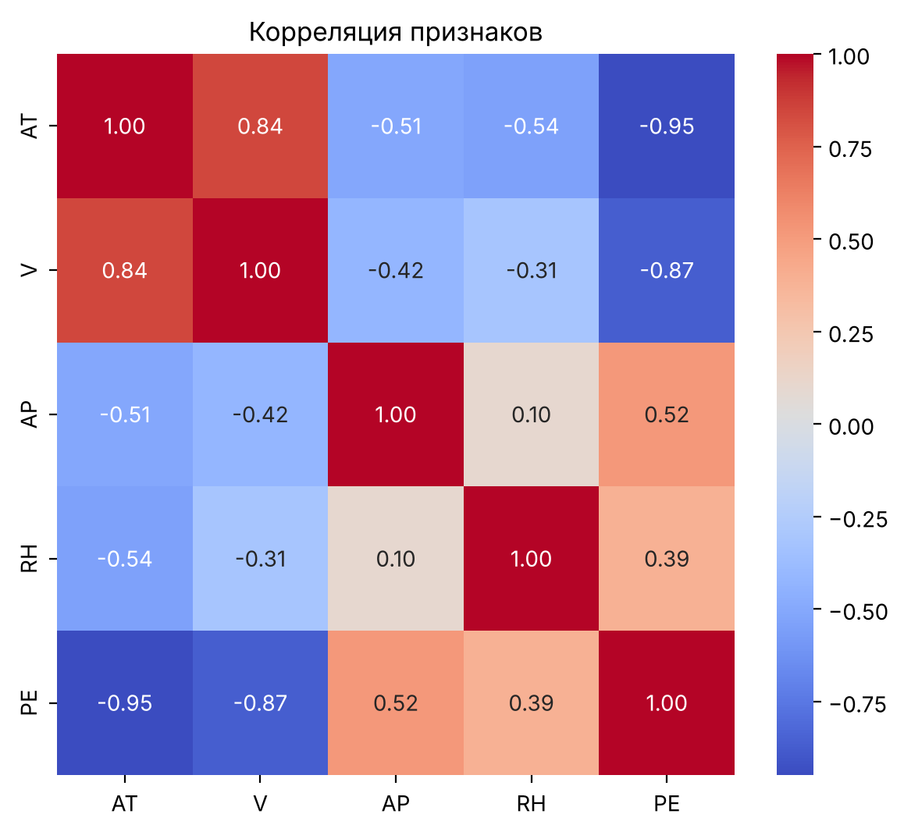
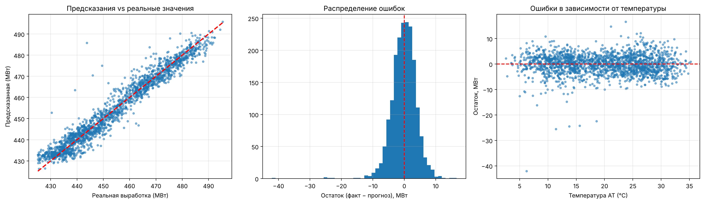
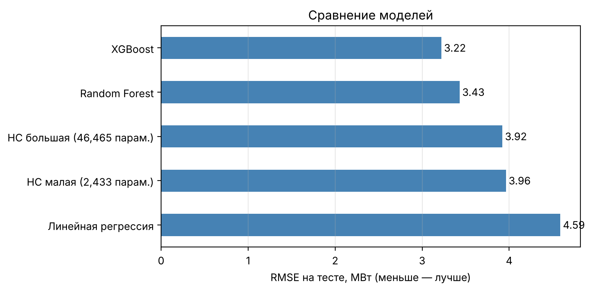

# Предсказание выработки электроэнергии на парогазовой электростанции

[](https://colab.research.google.com/github/Baiqa/ccpp-power-prediction/blob/main/ccpp_power_prediction.ipynb)

Итоговый проект по курсу «Системы искусственного интеллекта». Задача регрессии: по погодным условиям и вакууму предсказать чистую выработку электроэнергии (PE, МВт) парогазовой электростанции. Основная модель — полносвязная нейронная сеть на TensorFlow / Keras. Для сравнения обучены линейная регрессия, Random Forest и XGBoost.

📊 Презентация: [`presentation.pdf`](presentation.pdf)

## Данные

[Combined Cycle Power Plant](https://archive.ics.uci.edu/dataset/294/combined+cycle+power+plant), UCI Machine Learning Repository. Почасовые измерения за 2006–2011 гг.: 9 568 записей, после удаления 41 дубликата осталось 9 527.

| Признак | Описание | Единица |
|---|---|---|
| AT | Температура воздуха | °C |
| V | Вакуум на выхлопе | см рт.ст. |
| AP | Атмосферное давление | мбар |
| RH | Относительная влажность | % |
| **PE** | **Чистая выработка (цель)** | **МВт** |

Самая сильная связь с выработкой — у температуры (корреляция −0.95): в жару мощность станции падает.



## Подход

1. Удаление дубликатов, чтобы одинаковые строки не попали одновременно в train и test.
2. Разбиение 80 / 20 (`random_state=42`), затем `StandardScaler`, обученный **только на train** — без утечки данных.
3. Нейронная сеть 4 → 256 → 128 → 64 → 32 → 1 (ReLU, BatchNorm, Dropout), 46 465 параметров, Adam, MSE.
4. `EarlyStopping` (patience 40) и `ReduceLROnPlateau`.
5. Оценка на отложенной выборке: RMSE, MAE, R², анализ остатков.
6. Сравнение с другими моделями и 5-fold кросс-валидация.

## Результаты

**Нейросеть на тестовой выборке (1 906 примеров):** R² = 0.948, RMSE = 3.92 МВт, MAE = 2.91 МВт (0.64% от средней мощности 454 МВт). 84.7% прогнозов ошибаются меньше чем на 5 МВт.



**Сравнение моделей, 5-fold кросс-валидация (RMSE, МВт):**

| Модель | RMSE | ± std |
|---|---|---|
| XGBoost | **3.07** | 0.11 |
| Random Forest | 3.33 | 0.10 |
| НС большая (46 465 парам.) | 3.82 | 0.06 |
| НС малая, 64 → 32 (2 433 парам.) | 3.84 | 0.08 |
| Линейная регрессия | 4.56 | 0.06 |



## Выводы

- Нейросеть на 16% точнее линейной регрессии — нелинейные зависимости она улавливает.
- Сеть в 19 раз меньше даёт почти ту же точность: для 4 признаков большая архитектура избыточна.
- На табличных данных такого размера XGBoost точнее нейросети примерно на 20%.

**Ограничения:** данные одной станции; модель оценивает выработку по текущим показаниям, а не прогнозирует её на часы вперёд.

## Запуск

Проще всего — кнопка **Open in Colab** выше. Локально:

```bash
pip install -r requirements.txt
jupyter notebook ccpp_power_prediction.ipynb
```

Датасет скачивается в ноутбуке автоматически. Полный прогон с кросс-валидацией занимает около 10 минут на CPU.

## Структура

```
├── ccpp_power_prediction.ipynb   # ноутбук с кодом и результатами
├── presentation.pdf              # слайды проекта
├── images/                       # графики из ноутбука
└── requirements.txt
```

## Стек

Python · TensorFlow / Keras · scikit-learn · XGBoost · pandas · matplotlib · seaborn

---

Автор: [Baiqa](https://github.com/Baiqa) · Turan University
